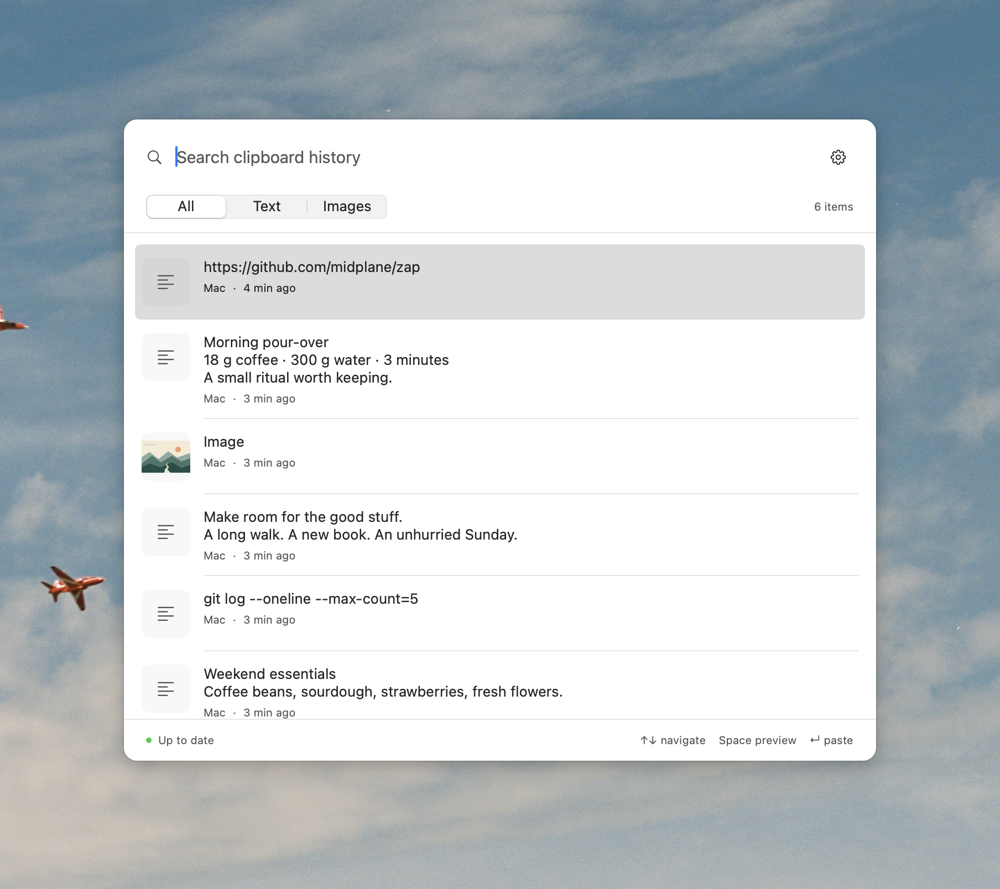
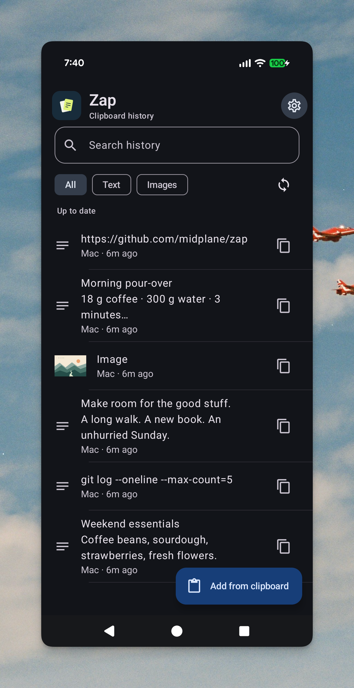

# Zap

**Private clipboard history for Mac and Android.** Copy text and images as usual, find them later with local search, and keep the same history across devices.

- **Native apps.** A keyboard-driven Mac panel and an Android app with sharing, previews, and quick copy.
- **Works offline.** Both apps keep local history with no account or server. Keep ten days by default, or choose from 1 to 365 days.
- **End-to-end encrypted sync.** Sync through a small server you deploy to your own Cloudflare account; content is encrypted before it leaves a device.

> ⚠️ Currently intended for personal testing. Review the security notes in this README and [SECURITY.md](SECURITY.md) before distributing or relying on it for important history.

<table>
  <tr>
    <th width="71%">Mac · light appearance</th>
    <th width="29%">Android · dark appearance</th>
  </tr>
  <tr>
    <td valign="top"><a href="docs/screenshots/mac-clipboard.png"></a></td>
    <td valign="top"><a href="docs/screenshots/android-clipboard.png"></a></td>
  </tr>
</table>

The same demo history on both devices. Select an image to view it at full size.

## Contents

- [Quick start](#quick-start) — prerequisites, build, deploy, pair
- [Daily use](#daily-use)
- [Package and install](#package-and-install)
- [Deploy and pair](#deploy-and-pair) — adding devices and troubleshooting
- [Verification](#verification)
- [Implementation and security](#implementation-and-security)
- [License](#license)

## Quick start

Both apps work fully offline with no server. Steps 1 and 2 are the only ones you need; add steps 3 and 4 to sync across devices.

### Prerequisites

| Target | Required |
| --- | --- |
| Mac app | Node 22+, a Swift 5.9+ macOS SDK (full Xcode recommended) |
| Android app | JDK 17, Android SDK 35 |
| Sync server | A Cloudflare account with R2 enabled |

No accounts or API keys are baked into the apps. Both apps use the identifier `dev.midplane.zap`; the Mac keeps its local database under `~/Library/Application Support/dev.midplane.zap` and its keys in Keychain.

### 1. Build the Mac app

```sh
./scripts/build-mac.sh
open dist/Zap.app
```

The script compiles with the active Xcode/Command Line Tools toolchain and caches the build in `mac/.build`; SwiftPM is not required. If a Command Line Tools upgrade left duplicate SwiftBridging module definitions, the script hides the duplicate with a local compiler overlay — system files are unchanged.

### 2. Build the Android app

```sh
cd android
# Set ANDROID_HOME to your SDK, or set sdk.dir in local.properties.
./gradlew assembleDebug
```

Install `android/app/build/outputs/apk/debug/app-debug.apk` on your phone. Keep the debug signing key if you want to update that installation without losing local data.

### 3. Deploy the sync server (optional)

```sh
cd backend
npm ci
npx wrangler login
cd ..
./scripts/deploy.sh
```

The script creates the `zap-content` R2 bucket, deploys the Worker/Durable Object, and prints a random setup token. If those names already belong to another project, change them in `backend/wrangler.jsonc` and the deploy script.

### 4. Connect your devices

1. On Mac, open Settings, enter the deployed Worker URL and setup token, and connect.
2. Choose **Pair another device**. On Android, open Settings → **Scan pairing code**.
3. Confirm the connection on the phone.

Your history now syncs. See [Deploy and pair](#deploy-and-pair) for adding more devices, replacing a Mac, and troubleshooting.

## Daily use

**Mac.** Copy text or an image as usual. Open Zap with **⌥Space (Option+Space)**, search, and press **Enter** to paste. Arrows select; Space previews when search is empty; ⌘C copies. Use the menu-bar icon for settings and startup options. Direct paste needs the macOS Accessibility permission.

**Android.** Share text or an image to Zap, or open Zap and choose **Add from clipboard**. Tap an item to preview, copy, share, or delete it. Android does not allow ordinary apps to watch the clipboard in the background, so new items are added without overwriting your current clipboard.

**Sync behavior.** Android refreshes when opened and requests a background refresh every 15 minutes while connected, when the network is available and the battery is not low; Android may delay that work, and pending shares retry through WorkManager. Mac uses live change notifications with a five-minute fallback check. Both apps back off failed live connections and reuse loaded history during sync. Settings control retention from 1 to 365 days (default 10).

## Package and install

```sh
./scripts/package.sh
```

Builds both apps and produces `dist/Zap-macOS-arm64.dmg` (`x86_64` on Intel Macs) and `dist/Zap-android-debug.apk`.

- **Mac.** Open the DMG, drag Zap into Applications, eject the disk, and launch `/Applications/Zap.app`. Quit Zap before replacing an existing copy.
- **Android.** Open the APK and allow installation from that source when prompted, or run `adb install -r dist/Zap-android-debug.apk` with a connected phone.

These are personal-testing packages: the APK uses debug signing and the DMG contains a locally signed app — packaging adds no release signing or notarization. For distribution, use your own Android release signing configuration and a Developer ID signature/notarization on Mac; `ZAP_SIGN_IDENTITY` selects the Mac signing identity, and the default is local ad-hoc signing. Keep the same app identifiers and signing keys for future updates.

## Deploy and pair

### Adding devices

- **Add any device.** Any connected device can create a code with **Pair another device**, then scan it on the new device.
- **Add a Mac.** To add a second or replacement Mac, copy the code from the pairing sheet and paste it into **Join existing history** in Settings — the same code works for a Mac or a phone.
- **Codes expire** after five minutes and can be used once. Only enrollment permission expires: the embedded encryption keys can still decrypt matching ciphertext afterward. Keep the entire code private, even after expiry. Manual code entry is available if scanning is inconvenient.
- **Disconnect** forgets the server connection while retaining local history; that history uploads when you connect to another server.
- Both apps save enrollment securely before contacting the server and resume it after a restart or lost response. Retry connecting to finish a pending attempt.

### Troubleshooting

- The setup token initializes a server once. If you see “This deployment is already initialized,” join using a pairing code from a connected device. This also applies after changing the app identifier; the previous app can still create a pairing code.
- One deployment is one personal device group. There is no login service, public sharing links, push provider, or paid Zap subscription. Cloudflare usage is billed to your account.

## Verification

```sh
cd backend
npm run check
npm test
cd ..
./scripts/check-mac-crypto.sh
./scripts/check-mac-store.sh
cd android
./gradlew testDebugUnitTest assembleDebug
```

The backend integration test runs a local Cloudflare runtime and covers pairing, idempotent uploads, deletion, expiration, and revocation. Native crypto checks use the same cross-platform vector, including Unicode, key wrapping, and tamper rejection.

## Implementation and security

**Components**

| Directory | What's inside |
| --- | --- |
| `mac` | SwiftUI/AppKit panel, pasteboard capture, SQLite, Keychain, CryptoKit |
| `android` | Compose, Room metadata, encrypted content files, Keystore, WorkManager, OkHttp |
| `backend` | TypeScript Worker, one SQLite Durable Object, R2 ciphertext |
| `protocol` | The current wire contract and shared crypto vector |

**Encryption.** All content is AES-256-GCM encrypted before upload; P-256 ECDH envelopes deliver keys to paired devices. The server stores only device names, identifiers, timestamps, sizes, and ciphertext. Search runs locally. Plaintext image files exist temporarily in Android's private cache when you explicitly copy or share an image. Clients currently trust the server's device roster during key rotation; protection against a malicious server substituting device keys is not implemented.

**Recovery.** Unreadable records are isolated so healthy history remains usable. Settings shows recovery status, retries, and an explicit **Discard damaged items** action. Synced records are downloaded again automatically. Unsent damaged records remain encrypted in local storage — including past their retention date — until repaired or explicitly discarded. Discarding while connected also queues deletion on paired devices; **Clear history** includes damaged records.

**Removal and retention.** Device removal revokes access and rotates encryption for future captures, but cannot erase content already downloaded to another device. An existing device can enroll a replacement; losing every paired device means starting with a fresh deployment/history. Do not delete encryption keys while keeping a local database you want to read. Retention removes items from active history and schedules blob cleanup, but does not guarantee forensic erasure from the OS or Cloudflare backups.

**Limits and sensitive content.** Plain text and static images only: 1 MiB text, 20 MiB PNG, 40 megapixels. No rich text, files, pins, OCR, analytics, or compatibility layers. Both apps reject captured text containing Zap pairing codes; Android masks manual pairing input and marks copied pairing codes as sensitive. This does not prevent another app with clipboard access from reading a copied code, and previously saved codes are not removed automatically — delete any such entries from history. There is no general filtering of passwords or other sensitive clipboard content.

## License

Licensed under the [MIT License](LICENSE), copyright 2026 Nikhil Bafna. This covers Zap's original code, documentation, and artwork. Third-party components, including the Gradle wrapper and application dependencies, retain their own [licenses and notices](THIRD_PARTY_NOTICES.md).
